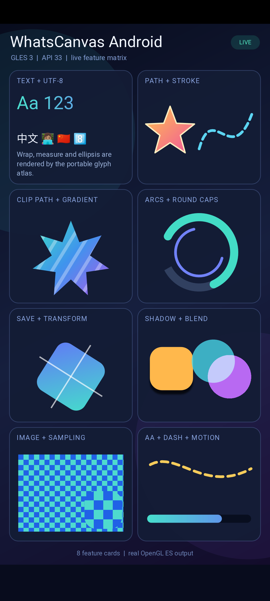
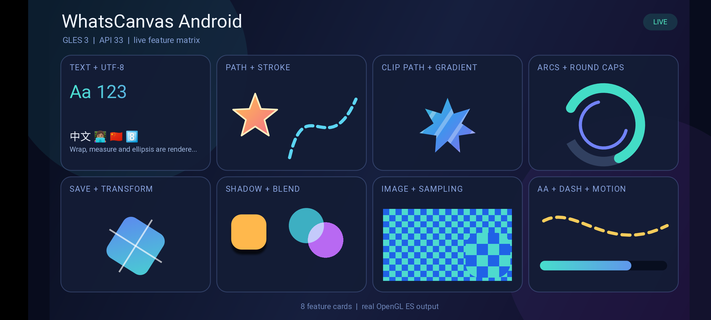

# Android 1.3.0 device validation — 2026-10-13

This check used the `1.3.0` branch and a Profile build on a Redmi K30
(Android 11, OpenGL ES 3.2, 1080 × 2400, density 2.75). The test APK used a
temporary alternate application ID to preserve the previously installed demo;
the application ID change is not part of the source change.

## Acceptance results

| Gate | Result |
| --- | --- |
| Profile build | `:app:assembleProfile` passed for all three configured ABIs. |
| Feature scene, fixed time 1.25 s | The renderer reported first frames at 1080 × 2305 portrait and 2305 × 1080 landscape. The eight cards, paths, shadow, blend, image sampling, CJK and emoji rendered. The text card's explanation stays below the mixed CJK/emoji line and inside its card in both captures. |
| Dynamic stress scenes | `text_stress`, `geometry_stress` and `compositing_stress` reported first frames without a process crash. Their first five-second callback windows were 59.4, 59.1 and 56.9 FPS. The next three compositing windows were 60.0, 59.7 and 60.0 FPS. A representative steady compositing frame reported about 2.5 ms recording and 3.1 ms flushing on the CPU. |
| Lifecycle and rotation | Returning from Home resumed the existing Activity without a crash. Rotation created new GLES surfaces and reported first frames in both orientations. |

The device later switched its active display mode from 60 to 30 Hz; the callback
rate then followed at roughly 29–30 FPS. These callback and CPU figures are a
device smoke check, not a presented-frame latency distribution or a GPU timing
result. The sample does not expose the 36-shadow benchmark on Android, so the
desktop shadow speedup is not verified on this device. iOS hardware was not
retested for this change.
